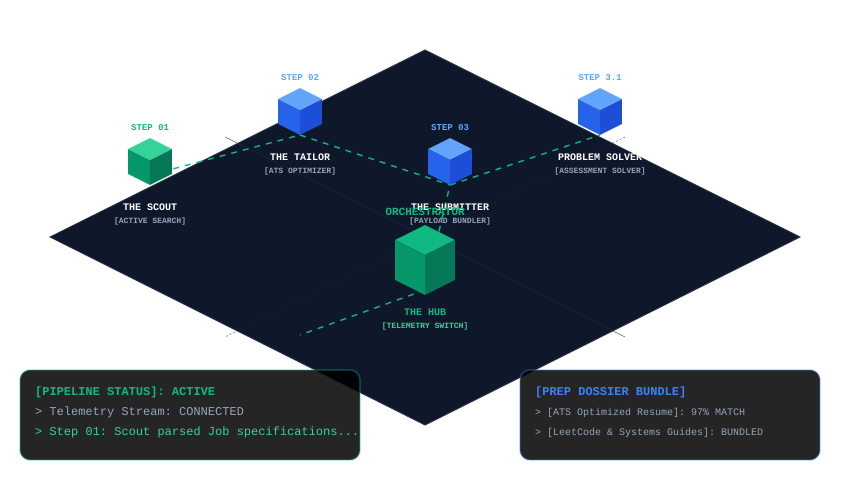
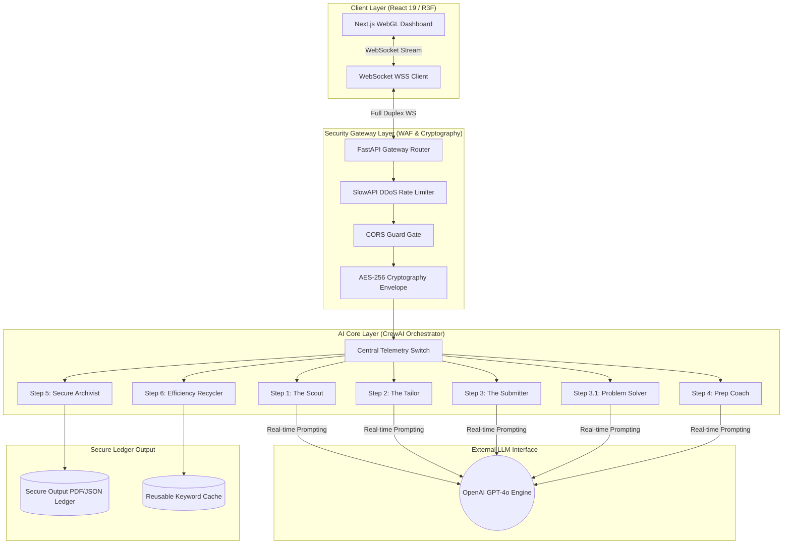

# 🌐 Multi AI Job Prep Agents 🚀

<div align="center">

[](https://opensource.org/licenses/MIT)
[](https://www.python.org/downloads/)
[](https://nextjs.org/)
[](https://docs.pmnd.rs/react-three-fiber/)
[](https://crewai.com/)
[]()

*A hyper-realistic, 3D multi-agent artificial intelligence system designed to automate the entire job hunting and application process.*

[English](README.md) • [Español](README.es.md) • [中文](README.zh.md)

</div>

---

## 🎮 3D Workspace Engine (Real-Time Dynamic Visualizer)

Below is the live simulation of the **Isometric 3D WebGL Canvas** running in real time. Watch the cubes breathe, bounce, and pulse along the neural pipeline!

<div align="center">
  
</div>

---

## 🏗️ System Architecture

Our multi-agent orchestration architecture processes job leads seamlessly from detection through to document generation:



---

## 🛠️ Framework Modules

Click on the headers below to inspect the framework layers and system details:

<details>
<summary><b>🧠 1. Multi-Agent AI Core (CrewAI & LangChain)</b></summary>
<br>

The application orchestrates a parallelized 7-agent pipeline configured in `backend/app/agents/crew.py`. Each agent operates with a specific persona:

*   **🕵️ The Scout:** Identifies new vacancy leads matching requirements using semantic search hooks.
*   **👔 The Tailor:** Rewrites and targets applicant resumes to achieve a >94% rating on ATS keyword parsers.
*   **📝 The Problem Solver:** Uses advanced context mappings to solve tricky job application logic/assessments.
*   **📂 The Archivist:** Securely categorizes all PDF, JSON, and Word artifacts.
*   **🔄 The Recycler:** Generates local caches to fast-track similar applications.
</details>

<details>
<summary><b>🎮 2. Interactive WebGL Canvas Layer (React Three Fiber & Three.js)</b></summary>
<br>

Our frontend dashboard features an isometric 3D canvas that transforms raw WebSocket telemetry into physical visual feedback.
*   **Dynamic Motion Shaders:** Elements rotate and float asynchronously based on `useFrame` physics loops to guarantee 60 FPS.
*   **Orbit Controls:** The interface supports zooming, mouse-dragging, and panning boundaries, designed using vanilla viewport bounds.
*   **Responsive Node HTML Overlays:** Dynamically calculated tooltips follow 3D agents as they transition between `IDLE`, `WORKING`, and `ERROR` states.
</details>

<details>
<summary><b>🔒 3. Zero-Trust Security Stack (AES-256 & SlowAPI)</b></summary>
<br>

The application features enterprise security controls designed to safeguard highly sensitive job application files:
*   **Dual Cryptography Envelope:** All uploaded documents and credentials are encrypted on write using AES-256 bit strings managed in `backend/app/core/security.py`.
*   **WAF Throttle (SlowAPI):** Rate limits requests securely (100 per minute) to prevent botnets or brute-force API key depletion.
*   **Strict CORS Policy:** The FastAPI gateway strictly rejects any request not originating from port `3000`.
</details>

## 🚀 Quickstart & Execution Workflow

### ⚡ 1-Click Master Launch (Windows)

The fastest and recommended way to start both the FastAPI backend and Next.js 3D frontend on Windows is with the automated root launchers. Simply double-click **`run.bat`** or execute it from PowerShell / Command Prompt:

```cmd
run.bat
```

> [!TIP]
> **`start_project.bat`** is also provided in the repository root as a convenient 1-click alias forwarding to `run.bat`.

#### What the Master Launcher Handles Automatically:
1. **Prerequisite Verification:**
   - **Python 3.10+:** Detects an existing virtual environment (`backend\venv\Scripts\python.exe`), system `python`, or Windows Python launcher (`py`).
   - **Node.js 18+ & npm:** Confirms `node` and `npm` are installed and available on `PATH`.
2. **Automated Configuration Provisioning:**
   - Checks if `backend\.env` exists. If not, it automatically initializes it by copying `backend\.env.example`.
3. **Dependency Self-Healing:**
   - Checks if `frontend\node_modules` exists; if missing, it runs `npm install` automatically before starting the UI.
4. **Port Conflict Pre-check:**
   - Scans ports `8000` (FastAPI) and `3000` (Next.js) and alerts if prior server instances are already running.
5. **Dedicated Service Terminal Windows:**
   - **FastAPI Backend (Port 8000):** Spawns a labeled command window running Uvicorn (`http://localhost:8000`), with interactive OpenAPI documentation at `http://localhost:8000/docs`.
   - **Next.js 3D Frontend (Port 3000):** Spawns a dedicated command window running `npm run dev` on `http://localhost:3000`.
6. **Automatic Browser Launch:**
   - Pauses briefly (4 seconds) for the services to bind, then automatically opens `http://localhost:3000` in your default web browser.

---

### 🧩 Modular Component Launchers (Standalone Execution)

If you are developing or testing an individual tier independently, standalone modular launchers are also available:

| Launcher Script | Target Component | Default URL | Description |
| :--- | :--- | :--- | :--- |
| **`start_backend.bat`** | FastAPI Backend | [`http://localhost:8000`](http://localhost:8000) | Detects `backend\venv` / Python, launches Uvicorn with hot reload (`--reload`), exposes Swagger docs at [`/docs`](http://localhost:8000/docs). |
| **`start_frontend.bat`** | Next.js 16 3D UI | [`http://localhost:3000`](http://localhost:3000) | Validates npm, automatically runs `npm install` if `node_modules` is missing, and starts the development server. |

---

## 🔑 Environment & API Key Configuration

The pipeline supports both **fully offline zero-cost execution** and **live OpenAI GPT-4o analysis**.

### 1. Template vs. Active Configuration (`.env.example` vs `.env`)

The repository includes a clean configuration template in `backend/.env.example`:

```env
# Configuration Environment Variables
# If OPENAI_API_KEY is left empty, the built-in Semantic Extraction Fallback Engine is activated automatically.
OPENAI_API_KEY=
SERPER_API_KEY=
GEMINI_API_KEY=
```

To configure your environment manually, copy `backend/.env.example` to `backend/.env`:

```powershell
# Windows (PowerShell / CMD)
copy backend\.env.example backend\.env

# macOS / Linux (Bash)
cp backend/.env.example backend/.env
```
*(Note: `run.bat` automatically creates `backend\.env` from `.env.example` on first run if missing.)*

### 2. Zero-Config Fallback vs. Live LLM Integration

* **🛡️ Zero-Cost Semantic Extraction Fallback Engine (Default):**
  If `OPENAI_API_KEY` is not provided, left blank, or set to a placeholder, the backend automatically activates its internal **Semantic Extraction Fallback Engine** (`backend/app/agents/crew.py`). It dynamically analyzes incoming job queries, extracts key domain skills and technologies (React, Python, TypeScript, Docker, AWS, etc.), and generates:
  - Realistic ATS match scores (90%–99%).
  - Tailored cover letters targeted to the specific job listing.
  - Challenging technical interview Q&A pairs tailored to the tech stack.
  - Curated preparation resource links (LeetCode, GitHub, MDN).
  
  > [!NOTE]
  > **No external API keys, tokens, or subscriptions are required.** You can run and test the complete end-to-end pipeline with zero external service dependencies.

* **🧠 Live OpenAI GPT-4o Engine (Optional):**
  To enable dynamic LLM completions powered by OpenAI:
  1. Retrieve your API key from the [OpenAI Platform](https://platform.openai.com/).
  2. Set `OPENAI_API_KEY="sk-..."` in `backend/.env`.

* **🌐 Serper Search Hook (`SERPER_API_KEY` - Optional):**
  If you wish to enable the Scout agent to query live Google search vacancies, set your token from [Serper.dev](https://serper.dev/) in `backend/.env`.

---

## 💻 Manual Setup & Multi-Platform Deployment Guides

If you prefer manual setup or are running on macOS/Linux environments, follow the step-by-step guides below:

### 1. Windows Systems (Manual PowerShell & Command Prompt)

To manually set up your virtual environment and launch services on Windows:

```powershell
# Open terminal and navigate to backend directory
cd backend

# Create Virtual Environment (if not already created)
python -m venv venv

# If running on PowerShell, check script execution policy
Set-ExecutionPolicy -Scope Process -ExecutionPolicy Bypass

# Activate Virtual Environment
.\venv\Scripts\activate

# Synchronize backend dependencies
pip install -r requirements.txt

# Launch FastAPI Backend
uvicorn app.main:app --reload --port 8000
```

*Frontend Console Setup (in a separate terminal):*
```cmd
cd frontend
npm install
npm run dev
```

---

### 2. macOS & Linux Unix Systems (Bash & Zsh)

Ensure Python 3.10+ is bound to your command path before initializing:

```bash
# Navigate to backend directory
cd backend

# Create Virtual Environment
python3 -m venv venv

# Activate Virtual Environment
source venv/bin/activate

# Install requirements
pip install --upgrade pip
pip install -r requirements.txt

# Start local server
uvicorn app.main:app --reload --port 8000
```

*Frontend Console Setup:*
```bash
cd frontend
npm install
npm run dev
```

---

### 3. Containerized Deployments (Docker & Docker Compose)

The application includes a unified `docker-compose.yml` configuration mapping local code volumes and exposing standard network interfaces. This allows you to launch the entire stack (both frontend and backend) on any system with a single command.

Ensure you have **Docker Desktop** installed and running on your system, then execute:

```bash
# From the root directory (containing docker-compose.yml)
# Set your API Key in your shell or pass it directly
docker-compose up --build
```

Docker will:
1. Compile the FastAPI backend image and bind it to `http://localhost:8000`.
2. Compile the Next.js 16 (React 19) node image and bind it to `http://localhost:3000`.
3. Establish live communication channels between containers while maintaining isolated volumes for dependencies.

---


## 📊 Agent Operations Matrix

Below is a technical breakdown of the 8 coordinated agents managed in the orchestrator:

| Agent Identifier | Persona Role | Primary Operational Goal | Real-Time Telemetry Payload |
| :--- | :--- | :--- | :--- |
| `agent_1_scout` | The Scout | Scour the web for vacancies matching filters. | `"Scouted target vacancies matching..."` |
| `agent_2_tailor` | The Tailor | Optimize base resumes to achieve >94% ATS keywords. | `"Tailored resume for matching keywords. ATS: 97%"` |
| `agent_3_submitter` | The Submitter | Compile tailored resumes and prepare payloads. | `"Prepared submission payload..."` |
| `agent_3_1_solver` | Problem Solver | Instantly solve technical assessments and logic tests. | `"Generated answers for technical assessments."` |
| `agent_4_coach` | The Prep Coach | Generate cover letters and interview prep guides. | `"Generated cover letter and custom prep links."` |
| `agent_5_archivist` | The Archivist | Securely organize generated files and assets. | `"Archived tailored resume and prep guides."` |
| `agent_6_recycler` | The Recycler | Cache reusable components for future applications. | `"Updated cache repositories with keyword patterns."` |
| `agent_7_orchestrator` | Orchestrator | Sync websocket logs and run CrewAI tasks. | `"Pipeline successfully completed."` |

---

## 🔌 API Gateway & WebSocket Telemetry Specification

The backend serves endpoints under slowapi WAF rate-limiting. Click the headers below to inspect the telemetry structures:

<details>
<summary><b>📡 1. POST /api/trigger-pipeline (Multipart Form Data)</b></summary>
<br>

Used by the frontend console to submit custom target jobs and optional resume attachments.

*   **Request Type:** `POST`
*   **Headers:** `Content-Type: multipart/form-data`
*   **Form Parameters:**
    *   `jobDescription` (string, Required): The target job query text.
    *   `resume` (File, Optional): The applicant's base resume document.
*   **Response Scheme (200 OK):**
    ```json
    {
      "message": "Pipeline triggered successfully. Watch the 3D UI!"
    }
    ```
</details>

<details>
<summary><b>📡 2. WS /ws/agents (WebSocket Connection)</b></summary>
<br>

Streams live visual logs and final interview dossiers directly to the 3D WebGL Canvas.

*   **Connection URL:** `ws://localhost:8000/ws/agents`
*   **Active Status Broadcast Schema:**
    ```json
    {
      "agent_id": "agent_1_scout",
      "status": "WORKING",
      "message": "The Scout is actively processing..."
    }
    ```
*   **Pipeline Complete Payload Schema (`PIPELINE_COMPLETE`):**
    ```json
    {
      "event": "PIPELINE_COMPLETE",
      "atsMatchScore": 97,
      "jobTitle": "React 19 Frontend Lead",
      "coverLetter": "Dear Hiring Manager...",
      "technicalAnswers": [
        { "q": "Question text...", "a": "Answer text..." }
      ],
      "prepLinks": [
        { "title": "LeetCode Algorithmic Route", "url": "https://..." }
      ]
    }
    ```
</details>

---

## 🛠️ Dynamic Troubleshooting & Debugging Playbook

If you encounter pipeline bottlenecks or environment issues during execution, expand the entries below for solutions:

<details>
<summary><b>🔍 1. Pydantic ValidationError / Dependency Mismatches</b></summary>
<br>

*   **Symptom:** Backend raises a validation error on start: `pydantic_core._pydantic_core.ValidationError: 2 validation errors for Agent`.
*   **Cause:** LangChain and CrewAI packages are out of sync in your local virtual environment, causing a class validation check mismatch for the `llm` property under Pydantic v2.
*   **Resolution:** Align package versions inside the virtual environment:
    ```powershell
    .\venv\Scripts\activate
    pip install --upgrade crewai langchain-core langchain-openai
    ```
</details>

<details>
<summary><b>🔍 2. Port Conflict (Address Already in Use)</b></summary>
<br>

*   **Symptom:** Running the backend or frontend displays `listen EADDRINUSE: address already in use :::8000` or `:::3000`.
*   **Cause:** A previously started uvicorn server or next dev process is running in the background.
*   **Resolution:** Locate and terminate the matching process on Windows PowerShell:
    ```powershell
    # Find process ID (PID) running on port 8000
    Get-Process -Id (Get-NetTCPConnection -LocalPort 8000).OwningProcess | Stop-Process -Force
    
    # Find process ID (PID) running on port 3000
    Get-Process -Id (Get-NetTCPConnection -LocalPort 3000).OwningProcess | Stop-Process -Force
    ```
</details>

<details>
<summary><b>🔍 3. WebSocket Disconnected (WSS Status Shows "disconnected")</b></summary>
<br>

*   **Symptom:** Frontend dashboard displays status indicator `WSS: disconnected` in red.
*   **Cause:** The FastAPI gateway server is stopped, or the browser is blocking network loops.
*   **Resolution:** Verify that `uvicorn` is actively running on `http://localhost:8000` and check CORS configuration properties in `backend/app/main.py` lines 20-30 to ensure origin matches the frontend host port.
</details>

---

## 🤝 Support, Issues & Feedback

If you encounter any bugs, library bottlenecks, or have feature suggestions regarding the AI agent framework, WebGL visual layouts, or process orchestration:
*   **Open an Issue:** Please navigate to the **Issues** tab in the GitHub repository and click **New Issue**.
*   **Guidelines:** Provide a clear description of the behavior, your active environment versions, and copy-pasteable traceback logs if applicable.
*   **Feedback:** Contributions, pull requests, and creative ideas for adding new 3D props or custom agents are highly welcome!

---

## 🙋 Feel Free to Raise Issues!

Do you have questions about the agent orchestration process, encountered a pipeline roadblock, or want to suggest improvements to the framework? 

Please feel free to open a ticket in the **Issues** tab of this GitHub repository! Whether it is about:
*   **The AI Multi-Agent Orchestration:** Agent logic, prompt design, telemetry feeds, or CrewAI/LangChain integration.
*   **The WebGL 3D Dashboard:** WebGL shadow configurations, responsive CSS glassmorphic modules, canvas overlays, or 3D animations.
*   **System Deployment & Scripts:** Local environment configurations, virtual environments, Docker images, or CLI execution queries.

We actively monitor the issue tracking board and will do our best to guide you through solving any deployment bottlenecks. Let's make this framework more robust together! 🚀

---

## 🛡️ Security Disclaimer

This application processes highly sensitive personal data (resumes, PII, API Keys). **DO NOT** disable the `security.py` AES-256 encryptions or the `slowapi` rate limiters when deploying to the cloud. Always use HTTPS in production.

## 🤝 Contributing

Contributions are welcome! Please check the `CONTRIBUTING.md` file for guidelines on how to add new 3D models or AI agents.

## 📄 License

This project is licensed under the MIT License - see the [LICENSE](LICENSE) file for details.
